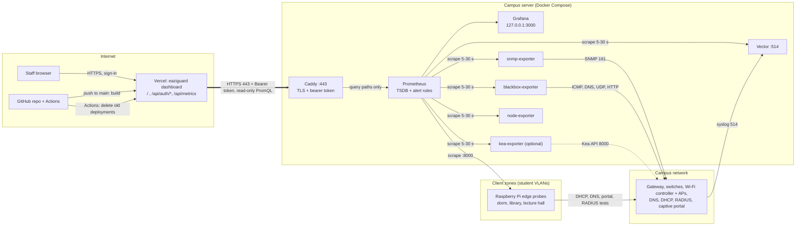
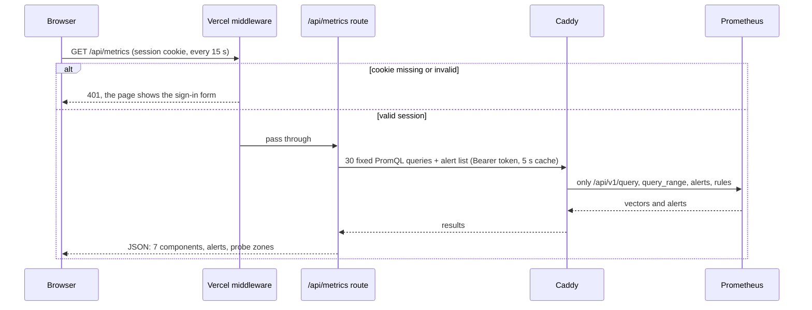

# eaziguard

Early-warning monitoring for a school or university campus network. It watches the
internet gateway/firewall, DNS/DHCP, AAA/RADIUS, core and distribution switches,
Wi-Fi controllers/APs and the captive portal, and raises a warning *before* users
start filing tickets.

**Contents:** [Architecture](#architecture) · [Alerts](#what-is-alerted-on) ·
[1. GitHub and Vercel](#1-push-to-github-and-connect-app-to-vercel) ·
[2. Campus server](#2-set-up-the-campus-server) ·
[3. Connect Vercel to the server](#3-connect-vercel-and-the-backend-securely) ·
[4. Raspberry Pi probes](#4-run-the-edge-probe-on-raspberry-pis) ·
[Troubleshooting](#troubleshooting) · [Verification status](#verification-status)

## Architecture

It is a three-part system, deployed on three different kinds of machine:

| Directory | Runs on | What it is |
|-----------|---------|------------|
| [`app/`](app) | Vercel | Next.js 15 + Tailwind dashboard: sign-in page, dashboard, and the `/api/metrics` proxy route |
| [`docker/`](docker) | Campus server | Docker Compose stack: Prometheus, Grafana, Vector, SNMP exporter, Blackbox exporter, node-exporter, Caddy (+ optional Kea exporter) |
| [`edge-probe/`](edge-probe) | Raspberry Pi / mini PC in client zones | Python synthetic probe exposing Prometheus metrics on `:8000` |



The thick arrow is the only link from the internet into the campus: Vercel to Caddy on port 443, carrying a bearer token.
Prometheus, Grafana and the exporters are reachable only from the server itself or its Docker network. Arrows into the
campus-network box apply to any device inside it.

**One dashboard refresh.** The browser never talks to Prometheus; the Vercel route holds the address and token and runs a fixed query list
(nothing the browser sends becomes a query):



**Ports and exposure**

| From | To | Port | Carries | Reachable from |
|------|----|------|---------|----------------|
| Browser | Vercel | 443 | Sign-in page and dashboard | Internet, login required |
| Vercel | Caddy | 443 | Read-only PromQL with bearer token | Internet, token required |
| Caddy | Prometheus | 9090 | The same queries, four paths only | Server only |
| Prometheus | Exporters | 9116 · 9115 · 9100 · 9598 · 9547 | Scrapes every 5–30 s | Docker network |
| snmp-exporter | Network devices | 161/udp | SNMP interface counters | Management network |
| blackbox-exporter | Network devices | ICMP · 53 · 67/udp · 1812/udp · 80/443 | Reachability, DNS, portal checks | Management network |
| Network devices | Vector | 514 udp/tcp | Syslog | Limit to management subnets |
| Prometheus | Raspberry Pi probes | 8000 | Probe metrics | Campus network |
| Raspberry Pi probes | DHCP · DNS · portal · RADIUS | 67/68 · 53 · 80/443 · 1812 | Tests from the client VLAN | Client VLANs |
| Operator | Grafana | 3000 on 127.0.0.1 | Graphs and rule status | SSH tunnel only |
| GitHub Actions | Vercel API | 443 | Delete older deployments | Internet, token required |

## What is alerted on

All rules live in [`docker/prometheus/alerts.yml`](docker/prometheus/alerts.yml) and carry a `severity`
(`critical` / `warning` / `info`) and a `component` label that the dashboard uses to colour its cards.

| Alert | Condition | For | Severity | Data source |
|-------|-----------|-----|----------|-------------|
| `DHCPPoolExhaustionWarning` | scope usage > 85 % | 5 m | warning | Kea exporter (`kea` profile) |
| `DHCPPoolExhaustionCritical` | scope usage > 95 % | 2 m | critical | Kea exporter |
| `APOffline` | no ICMP heartbeat | 90 s | critical | Blackbox ICMP, 15 s interval |
| `HighGatewayPacketLoss` | > 1 % loss over a 3-minute window | 1 m | critical | Blackbox ICMP, 5 s interval |
| `RADIUSAuthLatency` | AAA response > 500 ms | 3 m | warning | Edge probe (real RADIUS round trip) |
| `CoreSwitchInterfaceErrors` | CRC > 0.1/s, errors > 0.5/s or discards > 5/s per port | 10 m | warning | SNMP (IF-MIB, EtherLike-MIB) |

Supporting alerts cover switch/controller/DNS/DHCP/RADIUS/portal availability, portal certificate expiry,
slow or failing DNS/DHCP from each client zone, silent or stale edge probes, link flapping seen in syslog,
and the health of the monitoring stack itself.

Thresholds are deliberately conservative starting points. Tune them in `alerts.yml` after a week of data.

---

## 1. Push to GitHub and connect `app/` to Vercel

```bash
git clone https://github.com/cckhaw/eaziguard.git     # or: git init && git remote add origin <your repo>
cd eaziguard
git add . && git commit -m "Initial eaziguard import"
git push -u origin main
```

Then in Vercel:

1. **Add New → Project** and import the GitHub repository.
2. **Root Directory:** set it to `app` and **Framework Preset** to Next.js (this is what makes the monorepo work; `app/vercel.json` is read from there).
   If the preset stays on "Other", the build skips `app/` and every page returns 404.
3. **Environment Variables** (table below).
4. **Deploy.** Variables only apply to new deployments, so redeploy after changing any of them.

| Variable | Required | Meaning |
|----------|----------|---------|
| `PROMETHEUS_URL` | yes, unless `DEMO_MODE` | Public HTTPS address of the Caddy front door, for example `https://metrics.campus.example.edu`. No trailing path. |
| `PROMETHEUS_BEARER_TOKEN` | yes, unless `DEMO_MODE` | Shared secret; must equal the server's `PROMETHEUS_BEARER_TOKEN`. Mark it Sensitive. |
| `DASHBOARD_USER` / `DASHBOARD_PASSWORD` | yes in production | The sign-in. The older names `DASHBOARD_BASIC_AUTH_USER` / `DASHBOARD_BASIC_AUTH_PASSWORD` still work. |
| `SESSION_SECRET` | optional | Signs the session cookie independently of the password. |
| `DEMO_MODE` | optional | `true` serves built-in sample data (see below). Remove it for real monitoring. |
| `METRICS_CACHE_SECONDS` | optional | Per-instance snapshot cache, default 5. |
| `NEXT_PUBLIC_GRAFANA_URL` | optional | Adds a Grafana link to the header. |

### Sign-in

The front page of the dashboard is a login form (no browser pop-up). With `DASHBOARD_USER` and `DASHBOARD_PASSWORD` set, the data API only answers requests that carry a valid session.
A successful sign-in sets a signed, HTTP-only, same-site cookie valid for 8 hours; "Sign out" clears it. In production, with no credentials
set, the dashboard refuses to show data rather than falling back to open. Without `SESSION_SECRET`, changing the password signs everyone out.
Repeated wrong passwords are slowed down and temporarily rejected (best effort, per serverless instance), so use a long random password.
You can add Vercel Authentication in *Settings → Deployment Protection* as a second layer.

### Demo mode and local preview

Show the dashboard without a backend: add `DEMO_MODE=true` on Vercel and redeploy. The page then serves built-in sample data under a "Demo mode"
banner and ignores `PROMETHEUS_URL` / `PROMETHEUS_BEARER_TOKEN`. Keep the sign-in variables set so the demo isn't public, and remove `DEMO_MODE`
once the real backend is connected.

On your own machine, with nothing to configure (a fake Prometheus supplies the data):

```bash
cd app && npm install
npm run demo               # http://localhost:3000 with sample alerts
npm run demo -- healthy    # all-green variant
```

Development against a real backend:

```bash
cd app
cp .env.example .env.local        # fill in PROMETHEUS_URL and PROMETHEUS_BEARER_TOKEN
npm install
npm run dev                       # http://localhost:3000
npm run typecheck && npm run lint && npm test
```

### Deployment hygiene (already configured)

- **No preview builds.** Vercel's `git.deploymentEnabled` setting is not honoured for this project, so `app/vercel.json` uses `ignoreCommand`:
  every non-production build (branches, pull requests) is skipped immediately, and so is a production push that leaves `app/` unchanged.
  Skipped builds still appear in Vercel's list as "Canceled" entries; nothing is built or served for them.
- **Old deployments are deleted.** On every push to `main` that changes `app/`, the GitHub Action
  `.github/workflows/cleanup-vercel-deployments.yml` runs `scripts/cleanup-vercel-deployments.sh`. It waits until that push's production deployment is READY,
  then deletes every older Preview and Production deployment. The live deployment, anything newer, and anything still building are kept; if the new
  deployment is not READY after 15 minutes it deletes nothing and fails. Pushes that change only `docker/`, `edge-probe/`, `scripts/` or docs do not start it;
  run it by hand from the Actions tab instead (the dry run is the default).
- **One-time setup.** Add repository secrets (GitHub → Settings → Secrets and variables → Actions): `VERCEL_TOKEN` (vercel.com/account/tokens),
  `VERCEL_PROJECT_ID` (Project Settings → General) and `VERCEL_TEAM_ID` (Team Settings → General; if unset, the script reads the team from the project).
- **Rollback.** Deleting old production deployments also removes them as one-click rollback targets; to roll back, redeploy an earlier commit.

## 2. Set up the campus server

This is the machine that does the actual monitoring. Vercel cannot: its servers are on the public internet and cannot reach your switches,
access points, DHCP or DNS servers. Everything the dashboard shows is read from this server.

**What you need**

- A Linux host (Ubuntu 22.04 or 24.04 works well) with 2 vCPU, 4 GB RAM and 40 GB disk, on the campus network or a network that can reach your devices.
- Docker Engine 24+ with the Compose plugin.
- A public DNS name for it (for example `metrics.campus.example.edu`) pointing at the server's public IP.

| From → To | Port | Why |
|-----------|------|-----|
| Internet → server | 80/tcp, 443/tcp | Let's Encrypt challenge and the dashboard's HTTPS queries. Vercel has no fixed egress IPs, so the bearer token is the access control. |
| Switches / firewall / controllers → server | 514/udp, 514/tcp | Syslog into Vector. Restrict to your management subnets at the host firewall. |
| Server → devices | ICMP, 161/udp, 53, 67, 1812/udp, 80/443 | Polling and probing |
| Server → edge probes | 8000/tcp | Prometheus scrapes the probes |

If campus policy forbids inbound internet traffic to this host, a tunnel (for example Cloudflare Tunnel) in front of Caddy is the usual alternative. That is not
configured or tested here.

**Steps**

```bash
git clone https://github.com/cckhaw/eaziguard.git
cd eaziguard/docker
cp .env.example .env
openssl rand -hex 32               # this is your bearer token
$EDITOR .env
```

In `.env` set `PROMETHEUS_PUBLIC_HOST` (the DNS name), `ACME_EMAIL`, `PROMETHEUS_BEARER_TOKEN` (the token above), `GRAFANA_ADMIN_PASSWORD` and `SNMP_COMMUNITY`
(the read-only community of your devices). Docker refuses to start the stack until these are set.

1. **Inventory.** Edit the files in `docker/prometheus/targets/`: `gateway.yml`, `switches.yml`, `wifi_controllers.yml`, `aps.yml`, `dns.yml`, `dhcp.yml`,
   `radius.yml`, `portal.yml`, `portal_pages.yml`, `portal_hosts.yml` and `edge_probes.yml`. The shipped addresses are RFC 1918 examples.
   The `role` labels (`core-switch`, `distribution-switch`, `wifi-controller`, `dhcp-server`, `radius-server`) are used by alert rules, so keep them.
2. **Blackbox probes.** In `docker/prometheus/blackbox.yml` set `dns_internal.query_name` to a record your internal zone serves.
3. **SNMP.** Enable SNMP on the devices with the read-only community you put in `.env`.
   For SNMPv3, uncomment `campus_v3` in `docker/snmp/snmp.yml`, pass the variables to the `snmp-exporter` service, and change `auth: [campus_v2]` in `prometheus.yml`.
4. **Syslog.** Point devices at the server, for example Cisco IOS `logging host <server-ip> transport udp port 514`.
5. **Start it:**

```bash
docker compose up -d
docker compose ps                  # every service should be "running" / "healthy"
docker compose logs -f prometheus caddy
```

6. **Verify** (replace host and token):

```bash
curl -s -H "Authorization: Bearer $PROMETHEUS_BEARER_TOKEN" \
  "https://metrics.campus.example.edu/api/v1/query?query=up" | head -c 300
curl -s -o /dev/null -w "%{http_code}\n" "https://metrics.campus.example.edu/api/v1/query?query=up"   # 401 without the token
```

   Grafana and the full Prometheus UI are bound to `127.0.0.1` on purpose. Reach them through an SSH tunnel or VPN:
   `ssh -L 3000:127.0.0.1:3000 -L 9090:127.0.0.1:9090 user@server`, then open http://localhost:9090/targets to see which devices are up, and http://localhost:3000 for Grafana.

**DHCP scope alerts** need a metric source. The stack ships an optional exporter for ISC Kea:
set `KEA_CONTROL_AGENT_URLS` in `.env` and run `docker compose --profile kea up -d`. The recording rule
`campus:dhcp_scope_usage:ratio` in `alerts.yml` reads `kea_dhcp4_addresses_assigned_total` /
`kea_dhcp4_addresses_total`; for another DHCP server, change that one rule (or export metrics with those names).
Without a source, `DHCPPoolExhaustion*` never fires and the dashboard shows the scope-usage value as "—".

**Day-to-day:** edit a `targets/*.yml` file and Prometheus picks it up automatically. After editing `prometheus.yml`,
`alerts.yml` or `blackbox.yml`, reload with `docker compose kill -s SIGHUP prometheus` (or restart `blackbox-exporter`).
Validate rule changes before deploying them:

```bash
docker run --rm -v "$PWD/prometheus":/w -w /w --entrypoint promtool prom/prometheus:v2.55.1 test rules alerts.test.yml
```

Raw syslog is kept under the `vector-logs` volume (one directory per day, one file per host); prune it with a cron job.

## 3. Connect Vercel and the backend securely

Two variables tie the halves together:

| Variable | Set on Vercel | Set on the server (`docker/.env`) | Meaning |
|----------|---------------|-----------------------------------|---------|
| `PROMETHEUS_URL` | `https://metrics.campus.example.edu` | `PROMETHEUS_PUBLIC_HOST=metrics.campus.example.edu` | Public HTTPS address of the Caddy front door |
| `PROMETHEUS_BEARER_TOKEN` | the token | the same token | Shared secret; Caddy rejects any request without it |

After setting them, delete `DEMO_MODE` (or set it to `false`) and redeploy so the sample data gives way to real values.

How the pieces protect it:

- Browsers only ever call `/api/metrics` on your Vercel domain, and only with a valid sign-in session. The route runs a **fixed list of PromQL queries** on the server and
  adds the `Authorization` header there; the token is never sent to the browser or logged.
- Caddy terminates TLS, requires the exact bearer token, and forwards only `GET/POST` on `/api/v1/query`, `/api/v1/query_range`,
  `/api/v1/alerts` and `/api/v1/rules`. Everything else (UI, admin and lifecycle endpoints, remote write) returns 401.
- The app refuses a non-HTTPS `PROMETHEUS_URL` (except localhost) and refuses to follow redirects, so the token cannot leak to another host.
- Mark both variables **Sensitive** in Vercel, scope them to the environments that need them, and never commit `.env` files (they are git-ignored).

Rotating the token:

```bash
openssl rand -hex 32                       # 1. generate
$EDITOR docker/.env                        # 2. update PROMETHEUS_BEARER_TOKEN on the server
docker compose up -d caddy                 # 3. recreate Caddy with the new value
# 4. update PROMETHEUS_BEARER_TOKEN in Vercel and redeploy (Deployments → ⋯ → Redeploy)
```

Between steps 3 and 4 the dashboard shows "backend rejected the bearer token"; do them back to back.

## 4. Run the edge probe on Raspberry Pis

Deploy one probe per client zone: plug the Pi into a **client VLAN port** (the same VLAN as the devices you want to represent, with the same
DHCP, DNS and captive-portal treatment) and give it a stable address or DHCP reservation so Prometheus can scrape it.

What it measures every `PROBE_INTERVAL_SECONDS` (default 30 s):

| Test | Metrics |
|------|---------|
| DHCP | `edgeprobe_dhcp_success`, `edgeprobe_dhcp_offer_seconds` (DISCOVER→OFFER), `edgeprobe_dhcp_ack_seconds` in `full` mode |
| DNS | `edgeprobe_dns_success`, `edgeprobe_dns_resolution_seconds` per resolver and domain |
| Captive portal | `edgeprobe_captive_portal_up`, `…_redirect_detected`, `…_check_seconds`, `…_response_seconds`, HTTP statuses |
| RADIUS (optional) | `edgeprobe_radius_success`, `edgeprobe_radius_response_seconds`, `edgeprobe_radius_response_code` |
| Probe health | `edgeprobe_info`, `edgeprobe_last_run_timestamp_seconds`, `edgeprobe_run_duration_seconds`, `edgeprobe_test_crashed` |

Install as a systemd service (Raspberry Pi OS / Debian / Ubuntu, Python 3.9+):

```bash
git clone https://github.com/cckhaw/eaziguard.git && cd eaziguard/edge-probe
sudo ./install.sh                                  # user, venv in /opt/campus-edge-probe, unit, config template
sudoedit /etc/campus-edge-probe/probe.env          # PROBE_ZONE, PROBE_INTERFACE, DNS_*, PORTAL_*, RADIUS_*
sudo systemctl start campus-edge-probe
```

```bash
journalctl -u campus-edge-probe -f                 # logs
curl -s localhost:8000/metrics | grep ^edgeprobe_  # metrics
```

Then add the Pi to `docker/prometheus/targets/edge_probes.yml` (`- targets: ["<pi-ip>:8000"]`, `labels: {zone: library, role: edge-probe}`).
The `zone` label comes from that file. Re-run `sudo ./install.sh` to upgrade; it never overwrites your `probe.env`.

Notes:

- The service runs as an unprivileged user with only `CAP_NET_BIND_SERVICE` (bind UDP/68) and `CAP_NET_RAW` (pin to the NIC).
  To run by hand: `sudo env $(grep -v '^#' /etc/campus-edge-probe/probe.env | xargs) python3 probe.py --once`.
- `DHCP_MODE=discover` (default) sends DISCOVER and times the OFFER; it takes no lease. `full` completes REQUEST/ACK and then RELEASEs, using a
  derived locally-administered MAC so the Pi's own lease is untouched. If DHCP snooping verifies chaddr against the source MAC, `full` will be dropped; stay on `discover`.
- A captive-portal test is only meaningful from an **unauthenticated** network. On VLANs without a portal set `PORTAL_EXPECT_REDIRECT=false`.
- RADIUS needs the Pi registered as a RADIUS client with `RADIUS_SECRET`; the probe sends an Access-Request with a Message-Authenticator and treats
  Access-Accept, -Reject and -Challenge as "server responded", measuring the round trip. Use a throw-away test account.
- Tests: `cd edge-probe && pip install -r requirements.txt && python -m unittest discover -s tests -v`.

---

## Troubleshooting

| What you see | Likely cause and fix |
|--------------|----------------------|
| Every page returns 404 on Vercel | Root Directory is not `app` or the framework preset is "Other" (section 1, step 2). |
| "Sign-in is not configured" | `DASHBOARD_USER` / `DASHBOARD_PASSWORD` missing in production. Set them and redeploy. |
| "Dashboard is not configured" | `PROMETHEUS_URL` or `PROMETHEUS_BEARER_TOKEN` missing, or the URL is not `https://`. |
| "backend rejected the bearer token" | The Vercel and server tokens differ (see rotation above). |
| "backend unreachable" / "timed out" | Vercel cannot reach the server on 443: DNS name, firewall, or Caddy not running (`docker compose ps`). |
| Cards show "No data" | The matching targets file is empty or the exporter cannot reach the devices; check http://localhost:9090/targets over the SSH tunnel. |
| The page says "Demo mode" | `DEMO_MODE=true` is still set on Vercel. |
| DHCP card shows "—" for scope usage | No Kea exporter (or equivalent metrics) is configured. |
| Cleanup workflow says "Deployments to delete: 0" | Nothing is older than the live deployment. Check the listing printed in the run log. |

## Verification status

What was actually run while building this repository:

- `promtool check config` on `prometheus.yml` and `alerts.yml` (Prometheus 2.55.1), and `promtool test rules alerts.test.yml`: the five required alerts
  fire, hold off for their `for:` period, and render their annotations correctly on synthetic series.
- Edge probe: 20 unit/integration tests against in-process mock DHCP, DNS, HTTP-portal and RADIUS servers; a live `/metrics` endpoint check.
- Dashboard: `tsc`, ESLint, `next build`, 14 unit tests (status logic and session tokens), and end-to-end runs against a mock Prometheus that enforces the bearer token
  (healthy, degraded, wrong-token, unconfigured, non-HTTPS and sign-in paths), including the sign-in flow in a real browser, plus light, dark and phone-width screenshots.
- The Vercel deployment and the cleanup workflow: the dashboard builds and deploys from `main`; the cleanup ran as a dry run and then for real on GitHub Actions,
  deleting 20 older deployments and keeping the live one (it needed several fixes first, all merged).
- `docker compose config` parses the stack.

Not exercised, because there was no Docker daemon or lab network: the containers themselves, the Caddyfile and Vector pipeline
(`vector validate` was not run), `snmp.yml` against real devices, the Blackbox modules against real servers, and the Kea exporter. Run `docker compose up -d` and
work through the verification steps in section 2 on first deployment.

Known limits: UDP checks from Blackbox (`udp_radius_auth`, `udp_dhcp_server`) can only prove that a datagram was sent; the authoritative AAA and DHCP signals come from the edge
probes. No Alertmanager is included, so alerts are visible in the dashboard, Prometheus and Grafana but not pushed to email/Slack/pager. Add Alertmanager when you are ready to route notifications.
